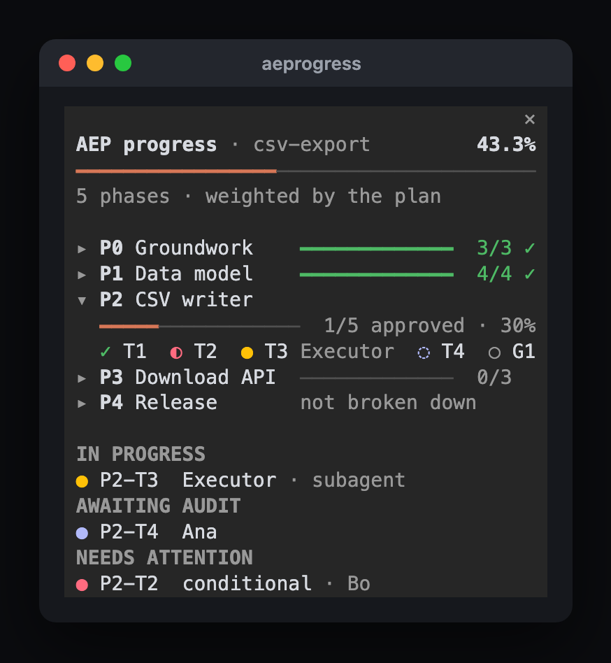
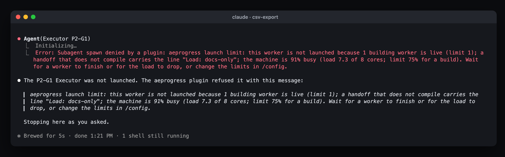
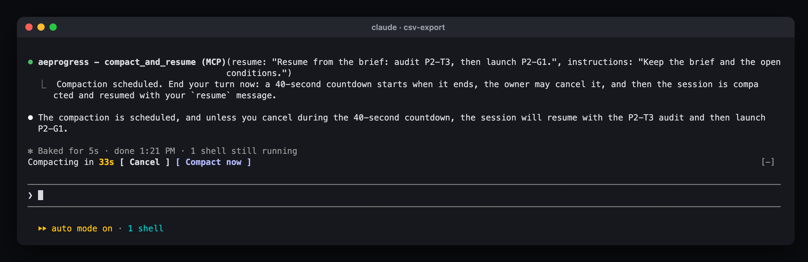

# Auditor/Executor Protocol

[](https://github.com/tBeltty/auditor-executor-protocol/actions/workflows/ci.yml)
[](https://pypi.org/project/aepkit/)
[](https://www.python.org/downloads/)
[](https://opensource.org/licenses/MIT)
[](https://github.com/astral-sh/ruff)
[](https://mypy-lang.org/)
[](https://doi.org/10.5281/zenodo.23633244)
[](https://github.com/tBeltty/auditor-executor-protocol/blob/main/pyproject.toml)

A protocol for multi-phase work done by AI agents, with two roles. The **Auditor** writes the plan as numbered tasks with gates, defines what "done" means for each, and checks every delivery by running it again. The **Executor** does one task at a time and pastes the command output that shows it works.

[`SKILL.md`](https://github.com/tBeltty/auditor-executor-protocol/blob/main/SKILL.md) holds the core of the protocol. [`references/`](https://github.com/tBeltty/auditor-executor-protocol/tree/main/references) holds the parts an agent reads only when it reaches that step: writing tasks and gates, handoff templates, Autonomous mode, failure modes and a worked example.

`aepkit` is a Python CLI with no dependencies. It scaffolds the documents, lints them for drift, runs negative controls, tallies status, and installs the skill into your agent. On Claude Code, an optional [plugin](#6-optional-the-claude-code-plugin) also shows a run's progress beside the chat, holds back Executor launches when the machine is busy, and compacts the Auditor's session when a phase closes.

---

## When to use it

For a script or a prototype, prompting an agent, reading the diff and shipping when it looks right is enough. It stops being enough where a mistake found late is expensive:

- financial calculations and balance transfers;
- authorization, tenant isolation and permission boundaries;
- destructive database migrations;
- background workers that run with nobody watching.

There, a diff that looks right proves little, and two failures come back session after session:

1. **The plan drifts.** The implementing agent meets an ambiguity, picks an answer and moves on without saying so. A few sessions later the work no longer matches the plan.
2. **The checks never ran.** A report says "reviewed and looks correct" about a check nobody executed, or a suite stays green because its fixtures skip the assertion that guards the boundary.

The protocol answers the first with four separate documents and the second with negative controls: a security check counts as verified once you have watched it fail with the protection removed.

---

## The two roles

| Role | Owns | Never | Output |
|---|---|---|---|
| **Auditor** | Instructions, gates, verdicts | Writes feature code | Task expansions, verdicts, remediation orders |
| **Executor** | Implementation, terminal evidence | Redesigns architecture, expands scope | Working code, unedited terminal output |

Before giving a verdict, the Auditor runs every verify command and gate again itself, so a pasted "tested and working" closes nothing on its own.

One person can hold both roles, in two separate agent sessions. Keep them separate, so the Auditor never checks its own work.

The owner picks one of two modes at the start of a run. In **Guided** mode the owner pastes each handoff into a fresh Executor session and sees every verdict. In **Autonomous** mode the Auditor launches Executors as subagents with an explicit model per task, answers their `BLOCKED` questions with a decision entry in the log, and reports once per closed phase, interrupting the owner only for a numbered critical-risk list ([`references/autonomous-mode.md`](https://github.com/tBeltty/auditor-executor-protocol/blob/main/references/autonomous-mode.md)).

When a phase closes, the Auditor's session can be compacted and resumed from the documents on disk. In Guided mode the owner does it by hand: `/compact`, then the resume message the Auditor gives. In Autonomous mode the Auditor does it alone, with the Claude Code plugin's `compact_and_resume` tool ([section 6](#6-optional-the-claude-code-plugin)), and the owner only gets a countdown to cancel it.

---

## The four documents

`aepkit init` creates the first three, and an empty `annexes/` folder for the fourth. They stay separate so the instructions an Executor follows never mix with the discussion behind them.

1. `plan-of-record.md` holds the what and the why: the opportunity (target outcome, problem, cost of doing nothing), three options compared or an explicit `N/A (Deterministic Fix/Compliance)` bypass, the riskiest assumption for the first phase to test, the decisions, the non-goals, the phases, and the deferred items ledger. Nobody implements from it.
2. `execution-guide.md` holds the how: numbered tasks (`P0-T1`) with their files, steps and literal verify commands, and a gate (`P0-G1`) that closes each phase.
3. `compliance-log.md` holds the evidence: a status board and one report entry per task and gate. The template starts with `P0-T1` and `P0-G1`; add an entry for each task you write. The Executor pastes command output here, unedited.
4. `annexes/` holds the corrections. After a `CONDITIONAL` or `REJECTED` audit, the Auditor writes a standalone annex and leaves the order already in flight untouched. A phase that keeps adding annexes was planned too thinly.

---

## Quickstart

### 1. Install `aepkit`

It needs Python 3.11 or later, and nothing else:

```bash
pipx install aepkit
```

To run the latest `main` instead, use `pipx install git+https://github.com/tBeltty/auditor-executor-protocol`.

Or from a clone, for development:

```bash
git clone https://github.com/tBeltty/auditor-executor-protocol.git
cd auditor-executor-protocol
pip install -e .
```

### 2. Install the protocol in your agent

This copies `SKILL.md` and its `references/` folder into your agent's skills, for one project or for your user. Cursor rules are a single file, so Cursor gets one `.mdc` with the references appended:

```bash
aepkit install-skill                     # auto-detects Antigravity, Claude Code, or Cursor
aepkit install-skill --agent antigravity # writes to .agents/skills/auditor-executor-protocol/
aepkit install-skill --agent claude      # writes to .claude/skills/auditor-executor-protocol/
aepkit install-skill --agent cursor      # writes to .cursor/rules/auditor-executor-protocol.mdc
aepkit install-skill --global            # user-level install (Antigravity unless --agent is given)
aepkit install-skill --dest <path>       # explicit destination; a non-SKILL.md file name gets one bundled file
```

Auto-detection checks the target directory for `.agents/` or `.gemini/`, `.claude/`, and `.cursor/`, then agent environment variables, and falls back to Antigravity. With `--global`, the skill goes to `~/.gemini/config/skills/`, `~/.claude/skills/`, or `~/.cursor/rules/`. An existing install is skipped unless you pass `--force`.

On Claude Code you can install the plugin in [section 6](#6-optional-the-claude-code-plugin) instead: it brings the same skill and the `aeprogress` pane.

### 3. Start a run

```bash
aepkit init docs/<task-name> --name "<Task Name>"
```

Creates `plan-of-record.md`, `execution-guide.md`, `compliance-log.md`, and `annexes/`. `--name` defaults to the directory name; existing documents are kept unless you pass `--force`.

### 4. Check status and drift

See what is open and how the verdicts add up:

```bash
aepkit status docs/<task-name>
```

`aepkit status --json docs/<task-name>` prints the same reading as JSON, with each ID's phase, effective state and executor, and the phases with their titles from `execution-guide.md` (and weights from an optional `Weight` column in the plan's phase table), for scripts and tools to use instead of parsing the log.

Check that the documents agree with each other:

```bash
aepkit lint docs/<task-name>
```

`aepkit lint` catches an empty guide, tasks without a report line, missing report entries, log entries with no matching task, `DONE` reports whose verify output is not pasted in a code block, gates without a stated negative control (hypothetical or waived ones do not count), work reported in a phase before every earlier phase is `APPROVED`, unfilled opportunity/shaping/non-goal fields in `plan-of-record.md` once work is reported `DONE` or audited, open rows in the deferred items ledger for a phase being closed, duplicated log paragraphs, and annex buildup past `--annex-threshold` (default 6 in total, with a per-phase breakdown). It checks that the evidence is there and in the right form. Whether it is genuine is for the Auditor's re-run to establish.

### 5. Run a negative control

When validating an authorization, tenant, or schema boundary:

```bash
aepkit negcontrol \
  --file server/middleware/auth.js \
  --break-cmd "sed -i '' 's/requireAuth/\/\/requireAuth/' server/middleware/auth.js" \
  --test-cmd "npm test -- auth.test.js" \
  --expect "401|Unauthorized"
```

The `sed -i ''` form above is BSD/macOS sed; on GNU/Linux use `sed -i 's/.../.../' file`.

`negcontrol` backs up the target file, applies the break mutation, confirms the test fails, restores the file with byte-level verification, confirms the test passes, and outputs a transcript ready for `compliance-log.md`. Without `--file`, pass `--restore-cmd` to undo the break yourself; with both, the backup still wins if the file is not byte-identical afterwards. `--file` needs `--break-cmd`, because the backup must be taken before the break. `--timeout` limits each command in seconds, and a test that hangs fails the control, since a hang catches nothing.

A failing test proves the protection works only when it fails for the reason you broke. A syntax error, a missing import or a mistyped test command also makes the test exit non-zero. `--expect` takes a regular expression that the failing run's output must match, and the control fails if it does not. Without `--expect`, output that looks like a syntax, import, collection or command-not-found error is flagged with a `WARNING` next to the `OK`, and you need to read the transcript to confirm the reason.

### 6. Optional: the Claude Code plugin

On Claude Code, one plugin, `auditor-executor-protocol`, brings the protocol as a skill (the same `SKILL.md` and `references/` that `aepkit install-skill --agent claude` installs) and `aeprogress`, a mod for runs where the Auditor launches Executors as subagents or as workers of a harness such as Orca.

The protocol works without the mod. The mod needs the protocol: it reads a run through `aepkit status --json`, so it needs `aepkit` and a run (steps 1 and 3), and without one it shows nothing.



1. A pane beside the chat shows the overall percentage, one bar per phase (weighted by an optional `Weight` column in the plan), who is working on which task ID (Claude Code subagents, Orca workers, or any other harness through a file it keeps), what awaits audit, what needs attention, and the machine's load. It refreshes after each turn, and every 20 seconds while it is open.
2. A launch limit: while a run is found, the mod refuses to launch another Executor past 2 live workers, 1 building worker, or a machine more than 75% busy for a build, and the refusal says which limit was hit. A handoff that builds nothing carries the line `Load: docs-only` ([`references/handoffs.md`](https://github.com/tBeltty/auditor-executor-protocol/blob/main/references/handoffs.md)) and only answers to the worker count. On macOS it also recommends excluding the project from Spotlight when indexing keeps the machine busy.

   

3. Compaction when a phase closes: in Autonomous mode, once a gate is `APPROVED` and the Auditor brief is up to date on disk, the Auditor calls the mod's `compact_and_resume` tool. After its turn, a 40-second countdown lets you cancel; then the session is compacted and the Auditor resumes from its own message. Typing a prompt, pressing Esc or running `/compact` yourself takes over.

   

Install the plugin at the prompt of a Claude Code terminal session, then open the pane on a run:

```
/plugin install auditor-executor-protocol --marketplace tBeltty/auditor-executor-protocol
/aeprogress docs/<task-name>
```

It works in the terminal and in the desktop app's local sessions (in the app: **+** next to the prompt, **Plugins**, **Add marketplace**). It needs Claude Code 2.1.287 or later, and every limit and feature is an option in `/config`.

It makes no network requests and sends no data anywhere, and its README lists every process it starts and everything it can refuse. To get new versions automatically, turn on auto-update once: `/plugin`, **Marketplaces**, `auditor-executor-protocol`, **Enable auto-update**.

Setup, options and how each number is computed: [integrations/claude-code/aeprogress](https://github.com/tBeltty/auditor-executor-protocol/tree/main/integrations/claude-code/aeprogress).

---

## CLI reference

| Command | Options | Description |
|---|---|---|
| `aepkit init <dir>` | `--name`, `--force` | Scaffold the three documents and `annexes/` from templates |
| `aepkit install-skill [dir]` | `--agent`, `--global`, `--dest`, `--force` | Provision `SKILL.md` and `references/` into Antigravity, Claude Code, or Cursor |
| `aepkit lint <dir>` | `--annex-threshold` | Cross-check IDs both ways, flag `DONE` without evidence, detect missing negative controls, and flag log rot |
| `aepkit negcontrol` | `--test-cmd` (required), `--file`, `--break-cmd`, `--restore-cmd`, `--expect`, `--timeout` | Run automated backup, break, fail, restore, and pass cycle |
| `aepkit status <dir>` | `--json` | Combine status board verdicts with reports; list everything not `APPROVED` |

`python -m aepkit` works the same as `aepkit`. Errors go to stderr.

Exit codes: `lint` and `negcontrol` return `0` when clean, `1` when they find a problem, and `2` on a usage error or missing document, so both can gate CI. `status` is informational and returns `0` whenever the compliance log exists.

`aepkit` reads and writes local Markdown files only: no external databases, daemons, or network calls. `negcontrol` runs the shell commands you pass it.

---

## Running the tests

With the standard library runner:

```bash
python3 tests/run.py
```

Or with `pytest`, after installing the test extras:

```bash
pip install -e ".[test]"
pytest
```

---

## Contributing

Contributions are welcome. [`CONTRIBUTING.md`](https://github.com/tBeltty/auditor-executor-protocol/blob/main/CONTRIBUTING.md) covers the development setup, the quality gates, and the PR checklist; participation follows the [`CODE_OF_CONDUCT.md`](https://github.com/tBeltty/auditor-executor-protocol/blob/main/CODE_OF_CONDUCT.md). Report vulnerabilities privately as described in [`SECURITY.md`](https://github.com/tBeltty/auditor-executor-protocol/blob/main/SECURITY.md). Changes are listed in [`CHANGELOG.md`](https://github.com/tBeltty/auditor-executor-protocol/blob/main/CHANGELOG.md).

## License

MIT (see [`LICENSE`](https://github.com/tBeltty/auditor-executor-protocol/blob/main/LICENSE)).

---

Made with ♥️ by [tBelt](https://github.com/tBeltty).
