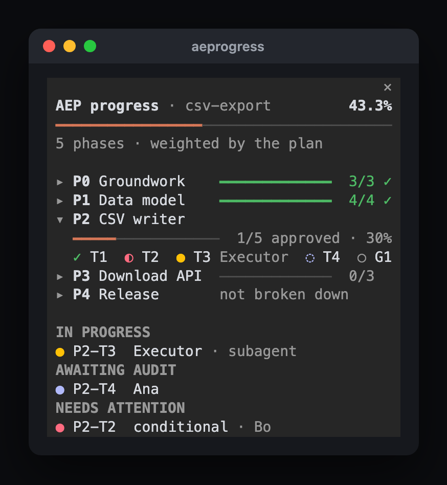
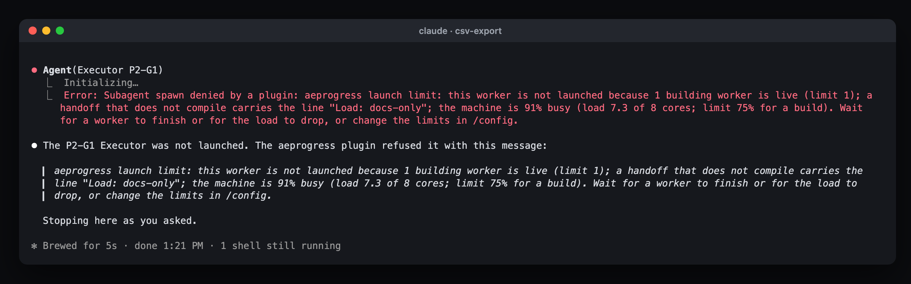
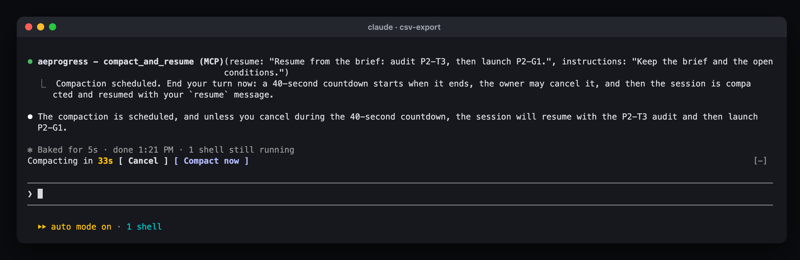

# Auditor/Executor Protocol for Claude Code



This plugin has two parts, and the second needs the first.

1. The Auditor/Executor protocol, as a skill. It is a method for agent work that spans
   several phases or sessions. An Auditor writes the plan of record, an execution guide
   of numbered tasks with gates, and the verdicts, and checks every delivery by running
   it again. Executors implement one task at a time and paste the command output that
   proves it into a compliance log. The skill is the protocol's `SKILL.md` and
   `references/`, the same files as in the
   [repository](https://github.com/tBeltty/auditor-executor-protocol). Claude loads it when
   you ask for phased work, an audit or a handoff, and
   `/auditor-executor-protocol:auditor-executor-protocol` calls it by name.
2. aeprogress, a pane that follows a run of that protocol. It reads the run's documents
   and shows, beside the chat:

- the overall percentage and a bar for the whole run;
- one bar per phase, with approved items over the total, and phases the plan declares
  that the execution guide has not broken down yet. Press a phase (a click, or Tab and
  Enter) to open it: its full title, its bar, and its tasks and gate with their state
  (✓ approved, ◐ conditional, ● in progress with who, ◌ awaiting audit, ○ pending,
  ✗ rejected, failed, blocked or conflict). The active phase, the first not fully
  approved, opens by itself until you close it;
- who is working on which task ID right now (IN PROGRESS), whether a Claude Code
  subagent, an Orca worker or a worker of any other harness;
- the items reported `DONE` that have no verdict yet (AWAITING AUDIT);
- the `CONDITIONAL`, `REJECTED`, `CONFLICT`, `BLOCKED` and `FAILED` items (NEEDS ATTENTION);
- the machine's load, with a colored dot, and how full the launch limit is.

Three more things come with the pane. A launch limit holds back another Executor when a
worker count or the machine's load would pass its limit, and says why. When a phase
closes, the Auditor can compact its own session and resume itself, after a countdown you
can cancel. On macOS, when Spotlight's indexing keeps the machine busy, the pane
recommends excluding the project folder.

In Autonomous mode the Auditor reports to you once per phase. The pane lets you follow
the run in between without interrupting it.

> **The pane needs a run.** aeprogress reads a run made with the protocol, through the
> `aepkit` CLI. Without one it shows "No compliance-log.md under this folder", and its
> launch limit and its compaction stay off. Start with the steps in
> [Start here](#start-here).

> **Claude Code versions.** Mods need Claude Code 2.1.287 or later. The mods API can still
> change between Claude Code releases; this mod is tested on 2.1.319, which CI pins.

## Start here

1. Install this plugin (see [Install](#install)).
2. Install the CLI the pane uses to read runs: `pipx install aepkit`.
3. Start a run. Ask Claude, for example: "Use the Auditor/Executor protocol to plan this:
   <your goal>". As the Auditor, Claude scaffolds the documents with
   `aepkit init docs/<task-name>`, fills the plan of record and the execution guide, and
   asks whether to run Guided (you hand each task to an Executor) or Autonomous (it
   launches Executors as subagents and reports once per phase).
4. Open the pane on the run: `/aeprogress docs/<task-name>`.

If you already installed the protocol with `aepkit install-skill`, Claude sees it twice;
keep one of the two.

## Requirements

- Claude Code with mods (function hooks): the terminal app, the desktop app's local
  sessions, or the IDE extensions.
- `aepkit` 0.7.0 or newer on the machine (`pipx install aepkit`, or
  `pipx upgrade aepkit`). The pane says so when it is missing or too old.

## Install

At the prompt of a Claude Code terminal session:

```
/plugin install auditor-executor-protocol --marketplace tBeltty/auditor-executor-protocol
```

Answer `y` to add the marketplace, then pick a scope (user scope loads it in every
session). From a shell:

```bash
claude plugin install auditor-executor-protocol --marketplace tBeltty/auditor-executor-protocol
```

In the desktop app, where `/plugin` does not run: click **+** next to the prompt box,
then **Plugins**, **Add marketplace** with `tBeltty/auditor-executor-protocol`, then
**Add plugin**. A mod installed from a terminal at user scope also loads in the desktop
app's local sessions.

### Keep it up to date

Claude Code updates plugins from a third-party marketplace like this one only when you
turn that on, once: run `/plugin`, open **Marketplaces**, select
`auditor-executor-protocol`, and choose **Enable auto-update**. From then on Claude Code
fetches new versions in the background during a session and offers `/reload-plugins`.
A copy installed from the claude.ai directory updates itself at every start, with nothing
to turn on.

Either way, the pane says when a newer `aeprogress` exists (see **Update check** in
[Options](#options-config)): it compares the running copy with the marketplace catalog
Claude Code keeps on disk, and at most once a day with the version published on GitHub.

## Use

```
/aeprogress              # open the pane on the run found under the working directory
/aeprogress docs/my-run  # open it on this run folder for the rest of the session
```

The command also answers with a one-line summary (`50% of docs/my-run: 1/2 approved`),
useful where no pane is drawn, such as `claude -p`.

The pane opens by itself when a session starts in a workspace with a run, where the
surface has room for it as a sidebar (in the terminal, from 144 columns). Turn that off
with **Open at session start** in `/config`.

### Which run it reads

1. The folder given to `/aeprogress <folder>`, for the rest of the session.
2. **Run folder** in `/config`, relative to the workspace or absolute.
3. Otherwise the most recently modified `compliance-log.md` up to three levels under the
   working directory (hidden folders, `node_modules`, `venv`, `dist`, `build`, `target`
   skipped).

## Who is working on what

The pane matches task IDs (`P<n>-T<m>`, `P<n>-G<m>`, in any case) against the IDs of the
run, so a worker of another project never shows. It looks in three places:

| Source | How it is read | When |
|---|---|---|
| Claude Code subagents | The session's own agent list, plus the task ID the spawn prompt named (`ROLE: Executor, reporting on P1-T3`), so an Auditor in Autonomous mode is followed with no setup | Always |
| Orca workers | `orca worktree ps --json`: a worktree whose name, branch or folder names the task ID and whose agent has not finished. Only worktrees of the run's repository count | **External workers** `auto` inside an Orca terminal, or `orca` |
| Any other harness | **Workers command**: a command that prints the workers running now, one per line. Every line that names a task ID of the run marks it in progress, and the line is shown as who | **External workers** `auto` or `command`, when the command is set |

A worker's name shows without the task IDs it carries (a subagent described as
`Executor P2-T3` shows as `P2-T3  Executor`), since the row already names the task.

A status board column named `Executor` (or `Worker`, `Agent`, `Owner`, `Assignee`) is
shown next to items awaiting audit or needing attention.

A workers command for a harness that writes one JSON object per running job could be
as small as `sh -c "my-harness jobs --running"`, as long as each line names the task ID.

## The launch limit

Several Executors that compile at once can saturate a machine, and a saturated machine
makes every one of them slower and flakier. While the session has a run, the mod holds
back an Executor launch that would pass any of these limits (each one a `/config` option):

| Limit | Default | Applies to |
|---|---|---|
| Most live workers | 2 | Every launch |
| Most building workers | 1 | A launch that builds |
| Busiest machine for a build | 75% | A launch that builds |



A refused launch never runs. The Auditor gets the reason back, such as
`2 workers are live (limit 2)` or `the machine is 90% busy (load 7.2 of 8 cores; limit 75%
for a build)`, and can wait for a worker to finish.

### Which launches it sees

| Launcher | What counts as a launch | How live workers are counted |
|---|---|---|
| Claude Code subagents | A subagent whose prompt names a task ID of the run (an Executor handoff). Exploration, review and workflow subagents are never held back | The session's own agent list |
| Orca | `orca orchestration worker-start`, and `orca orchestration send --to dispatch:<id>` when that dispatch is not live (it reopens the worker). A message to a live worker or to the coordinator, such as a worker's own report, is never held back. `orca` must be the command itself: the same words inside an `echo` or a commit message are not a launch | `orca orchestration worker-list --json`: workers `live` and `in_progress`. Without a bound Run that is every Orca worker on the machine, which is what a machine-wide limit wants. If Orca cannot be asked, the launch is refused, to stay on the safe side |
| Any other harness | Not seen: its launches go through without the limit. Its workers still show in the pane through the workers command | |

Claude Code subagents and Orca workers are counted together.

### Builds and docs-only handoffs

A handoff that compiles, builds and tests nothing (documentation, a plan, a review)
carries the line `Load: docs-only`, as `references/handoffs.md` describes.
The mod looks for it in the subagent's prompt, in the Orca command (`--spec "..."`), or in
the file `--spec-file` names (read from the session's working directory). Anything without
it counts as a build. A docs-only launch only answers to the worker count.

Turn the limit off with **Launch limit** in `/config`; without a run it does nothing.

## Machine load

The mod API does not say which system it runs on, so the mod tries each source by what
exists, and turns it into one number, the busy fraction:

| System | Source | Busy fraction | Tested |
|---|---|---|---|
| Linux | `/proc/loadavg` over the processors in `/proc/cpuinfo` (`nproc` when cpuinfo lists none) | 1-minute load / cores | Parser checked against a real kernel's output (arm64 container); not yet run inside Claude Code on Linux |
| macOS, BSD | `sysctl -n vm.loadavg` over `sysctl -n hw.ncpu` | 1-minute load / cores | macOS: run for real |
| Windows | PowerShell, `Win32_Processor` `LoadPercentage` averaged | CPU % / 100 | Simulated output only |

A system where no source answers shows "Machine load unknown", and the limit then
applies only its worker counts.

## Spotlight recommendation (macOS)

Spotlight indexes new files as they appear, and a build that writes thousands of them
can keep `mds_stores` and `mdworker` busy for minutes. When their CPU, added up, stays at
or above 50% on two reads in a row (20 seconds apart while the pane is open), the pane
recommends excluding the project folder (the run's git repository root) in
**System Settings > Spotlight > Search Privacy** (**Spotlight > Privacy** on older
macOS), shows the exact path, and toasts once per session. A launch the limit refuses
while Spotlight is busy says so too.

The mod only recommends. It never changes a setting, runs `mdutil` or writes into the
folder. Turn it off with **Spotlight recommendation** in `/config`, or change its
threshold. Other systems never show it.

## Compacting when a phase closes

This is how the protocol's Autonomous mode compacts: the Auditor calls the tool at each
phase close, and you don't have to do anything. In Guided mode the protocol keeps
compaction manual (you run `/compact` and paste the resume message the Auditor gives), and
the Auditor does not call this tool.

In Autonomous mode the Auditor waits on its workers for long stretches, and a session
that carries every earlier phase gets expensive whenever its prompt cache expires.
When a phase closes (gate `APPROVED`, work pushed, Auditor brief up to date on disk),
everything needed to go on is on disk, so the session can be compacted.

The mod gives the Auditor a tool, `compact_and_resume` (`mcp__auditor-executor-protocol__compact_and_resume`):

| Input | What it is |
|---|---|
| `resume` (required) | The message that resumes the Auditor after compacting, such as `Resume the plan from the brief: launch the first task of P2` |
| `instructions` | What the compaction summary must keep |



The Auditor calls it and ends its turn. When the turn ends, a band above the prompt
counts down 40 seconds with **Cancel** and **Compact now**. At zero the session is
compacted, as `/compact` does, and the `resume` message is sent, which opens the
Auditor's next turn.

You can step in at any point:

- Cancel compacts nothing and resumes nothing.
- Typing a prompt during the countdown drops it, since you took over.
- Pressing Esc on the Auditor's turn drops it too.
- Running `/compact` yourself while it counts down clears the countdown, and the
  `resume` message is sent once, after your compaction.

If the compaction is refused (a turn is running) or another plugin vetoes it, the
Auditor is not resumed: a toast says so and the owner decides. A countdown survives a
reload of the mod. The tool is offered only in interactive sessions, where something
can resume; turn it off, or change the seconds, in `/config`.

## How the percentage is computed

- Each phase weighs 1, unless the plan's phase table has a `Weight` column:

  ```markdown
  | Phase | Delivers | Risk | Weight |
  |---|---|---|---|
  | P0 | Groundwork | low | 1 |
  | P1 | The core feature | high | 3 |
  ```

- Inside a phase every task and gate counts the same. `APPROVED` counts 1, since only
  `APPROVED` closes an item. `CONDITIONAL` counts 0.5: the work is accepted except for
  named items, so it moves the bar but never lets a phase reach 100%. Every other state
  counts 0.
- A phase the guide has not broken down counts 0 with its full weight, so the overall
  percentage does not jump when a new phase is expanded.
- Task IDs the guide lists and the log has no row for yet count as `PENDING`.

## What it does on your machine

`aeprogress` is a mod: code that runs inside Claude Code with your permissions. This
section lists everything it does, so you can decide whether to trust it. `claude plugin validate` on
this folder lists the same events and calls.

### Processes it starts

Each one is short, has a time limit (15 seconds, 8 for
PowerShell, 3 for the load readings), runs without a shell, and is never left running.

| Command | When | Why |
|---|---|---|
| `aepkit status --json <run folder>` (or `~/.local/bin/aepkit`, `python3 -m aepkit`, `python -m aepkit`, `py -m aepkit`, or the **aepkit command** you set) | Each refresh | Reads the run's progress |
| `git rev-parse --show-toplevel` in the run folder | Once, when Spotlight indexing stays busy | The folder to name in the Spotlight recommendation |
| macOS and BSD: `sysctl -n vm.loadavg`, `sysctl -n hw.ncpu`; macOS also `ps -A -o %cpu=,comm=` | Each refresh, and before each launch the limit judges | The machine's load, and Spotlight's indexing CPU |
| Linux: `nproc`, only when `/proc/cpuinfo` lists no processors | Same | The machine's load |
| Windows: `powershell -NoProfile -Command` reading `Win32_Processor.LoadPercentage` | Same | The machine's load |
| `orca worktree current --json`, `orca worktree ps --json`, `orca orchestration worker-list --json` | Inside an Orca terminal, or with **External workers** set to `orca` | Orca workers in progress, and the live count for the limit |
| The **Workers command** you set, in the run folder | Each refresh, only if you set one | Workers of another harness |

### The one network request it makes

With **Update check** on `daily` (the default), at
most once a day, at session start, it asks GitHub for
`https://raw.githubusercontent.com/tBeltty/auditor-executor-protocol/main/integrations/claude-code/aeprogress/.claude-plugin/plugin.json`
and reads only its `version`. The request carries nothing of yours, it goes through
Claude Code (which applies your organization's web-fetch policy), and it is skipped when
`CLAUDE_CODE_DISABLE_NONESSENTIAL_TRAFFIC` is set, for a copy installed from the claude.ai
directory, and with **Update check** on `offline` or `off`. The date of the last check and
the version it found are kept in the plugin's own storage, so the next session knows
whether a day has passed.

Refreshes happen at session start, when `/aeprogress` runs, after each turn, when a
subagent starts or stops, and every 20 seconds only while the pane is open.

### Files it reads

The run folder's `compliance-log.md`, `execution-guide.md` and
`plan-of-record.md` (through `aepkit`); the working directory's folder names, up to three
levels, to find a run; the `--spec-file` an Orca `worker-start` names, to look for
`Load: docs-only`; on Linux, `/proc/loadavg` and `/proc/cpuinfo`. It writes no files.

### Environment variables it reads

`HOME` and `USERPROFILE` (to find aepkit),
`ORCA_CLI_BIN_DIR` and `ORCA_WORKTREE_ID` (to know it runs inside Orca), `SystemRoot`
and `WINDIR` (to know it runs on Windows), and `CLAUDE_CODE_DISABLE_NONESSENTIAL_TRAFFIC`
(to skip the version check). It sets none.

### What it can refuse

While a run is found and **Launch limit** is on, it refuses:

- a call to Claude Code's `Agent` tool whose prompt or description names a task ID of the
  run (an Executor launch), past the limits in [The launch limit](#the-launch-limit);
- a Bash command that runs `orca orchestration worker-start`, or `orca orchestration
  send` to a dispatch that is not live, past the same limits, or when Orca cannot count
  its workers.

Every refusal says why. The mod answers those two tools' calls itself only to refuse
them; a launch within the limits goes on unchanged, and the tool's own result comes back
as it was. Any other subagent, command or tool call goes through untouched. The limit
keeps your own run from saturating your own machine; turn it off with **Launch limit**
in `/config`.

### What it does to your session

It registers the `/aeprogress` command and one tool,
`compact_and_resume`, that Claude can call. After that tool is called and the turn ends,
and only if nobody cancels the 40-second countdown, it compacts the session (as
`/compact` does) and submits the `resume` text Claude gave as the next prompt. It shows
toasts for a refused launch, a vetoed compaction, a newer version and the Spotlight
recommendation.

### The prompts it submits

Only one kind: after a compaction it submits, as the next
prompt, the `resume` text exactly as Claude passed it to `compact_and_resume`, with
nothing added, removed or rewritten. It submits nothing else, and it never edits a prompt
you type.

### Every hook it registers

| Hook | What it does | What it changes |
|---|---|---|
| `session.start` | Registers `/aeprogress` and the `compact_and_resume` tool, reads the run, starts the 20-second timer (it reads only while the pane is open), opens the pane when a run is found, and starts the version check in the background | Nothing: the session starts as it would |
| `command.run`, for `/aeprogress` only | Reads the run, opens the pane, and answers with a one-line summary | Nothing else; it answers only its own command |
| `tool.call`, for `Agent` | Reads the call's prompt and description for task IDs of the run; for an Executor launch past the limits, answers with a refusal; after a launch, keeps the new subagent's id with those task IDs | Only the refusal; otherwise the call and its result pass unchanged |
| `tool.call`, for `Bash` | Looks only for `orca orchestration worker-start`, or `orca orchestration send` to a dispatch that is not live; past the limits, answers with a refusal; after a launch, keeps the dispatch id it printed | Only the refusal; every other command, and every result, passes unchanged |
| `tool.call`, for `mcp__auditor-executor-protocol__compact_and_resume` | Its own tool: keeps the compaction to run when the turn ends and answers with a sentence asking Claude to end its turn | Nothing outside its own tool |
| `classic.SubagentStop` | Reads the run again, so the pane drops the finished subagent | Nothing |
| `turn.complete` | Reads the run again while the pane is open; at the end of the main conversation's turn starts a scheduled compaction's countdown, or drops it if you pressed Esc | Nothing |
| `prompt.submit` | When you type a prompt while a compaction is scheduled, drops the countdown, since you took over | Nothing: your prompt passes as you typed it |
| `session.compact` | When you run `/compact` yourself while a countdown is pending, drops the countdown and, after your compaction ends, submits the `resume` prompt once | Nothing: your compaction runs as you asked |
| `ui.render`, for the pane | Draws the pane | Only its own pane |
| `ui.render`, for the band above the prompt | Draws the countdown band while a compaction is scheduled | Nothing at any other time: the band is left to Claude Code |

## Privacy

`aeprogress` sends nothing about you anywhere: no telemetry, no analytics, no data to the
author or to any service. Its only network request is the daily version check above, a
plain request for a public file, and you can turn it off.

What it reads stays in your Claude Code session, in memory, and is gone when the session
ends. Only the version check keeps anything between sessions: the date of the last check
and the version it found.

The processes above run on your machine. Two of them can reach beyond it, and you control
both: Orca's CLI talks to the Orca app on your machine and to any Orca servers you paired
yourself, and a Workers command does whatever you wrote it to do.

## Options (`/config`)

| Option | Default | What it does |
|---|---|---|
| Run folder | empty | The run to read; empty searches the working directory |
| External workers | `auto` | `auto`, `orca`, `command` or `off` |
| Workers command | empty | The command for any other harness |
| aepkit command | empty | How to run aepkit, such as a full path |
| Open at session start | on | Open the pane when a run is found |
| Launch limit | on | Hold back Executor launches past the limits below, while a run is found |
| Most live workers | 2 | Subagents and Orca workers together |
| Most building workers | 1 | Live Executors without `Load: docs-only` |
| Busiest machine for a build (%) | 75 | No building launch above this load |
| Spotlight recommendation (macOS) | on | Recommend excluding the project from Spotlight |
| Spotlight CPU that triggers the recommendation (%) | 50 | Indexing CPU held on two reads in a row |
| Compact on phase close | on | Offer the Auditor the `compact_and_resume` tool |
| Compaction countdown (seconds) | 40 | How long the band waits before compacting |
| Update check | `daily` | `daily`: the catalog on disk, and GitHub at most once a day. `offline`: the catalog on disk only. `off`: no check |

## Develop

```bash
claude plugin validate integrations/claude-code/aeprogress
claude plugin test integrations/claude-code/aeprogress
claude --plugin-dir integrations/claude-code/aeprogress
```

The tests stand in for `aepkit` with `tests/fixtures/status.ts`, the JSON that
`aepkit status --json` prints for the sample run in the repository's
`tests/test_status.py`. That Python test checks that aepkit still prints exactly that
JSON, so a change to either side fails a test.
